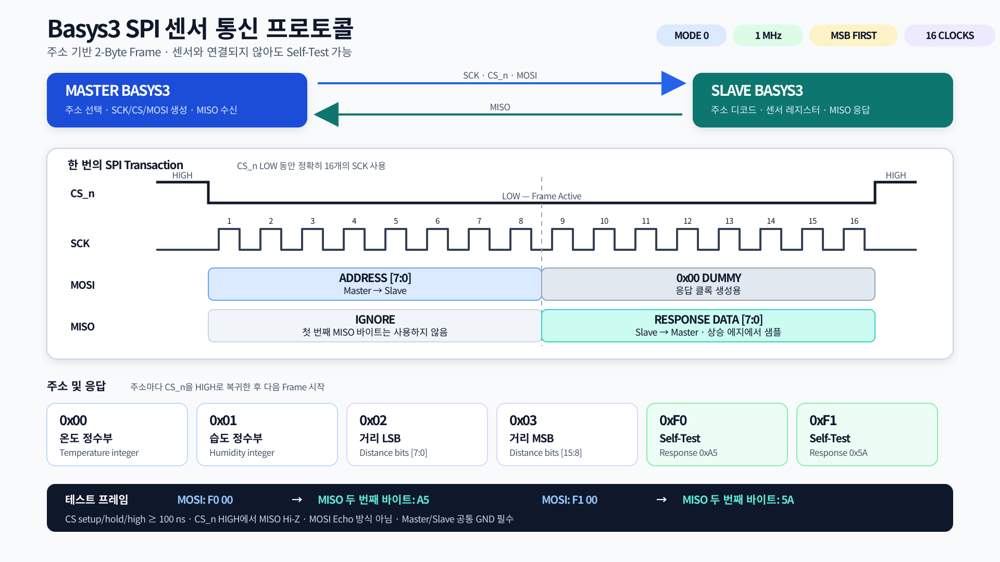
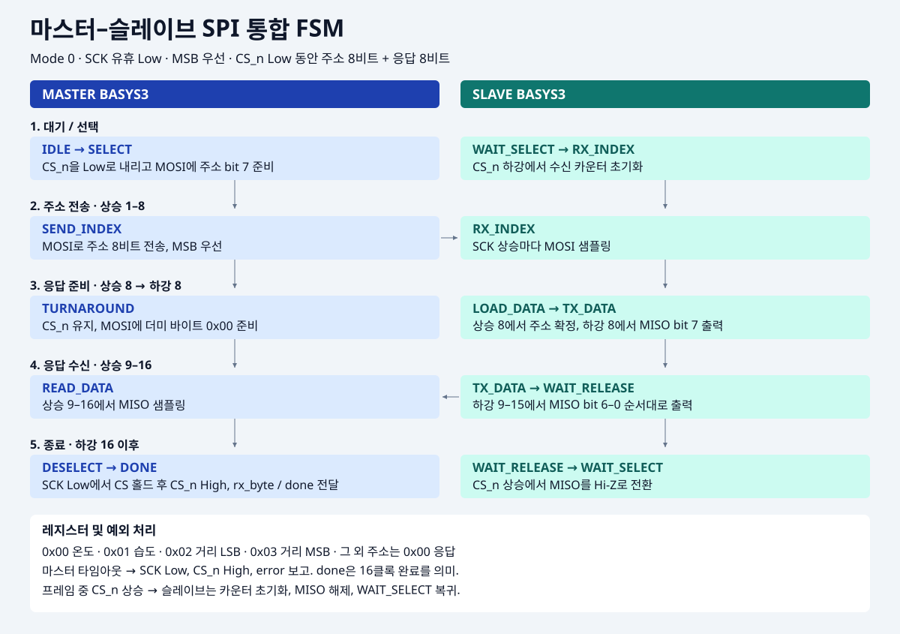

# FPGA SPI Slave 기반 온습도·거리 모니터링 시스템

> **Basys3 FPGA · Verilog · Vivado 2021.2 · SPI Mode 0 · DHT11 · HC-SR04 · UART · 7-Segment**

Basys3 FPGA에서 **DHT11 온도·습도** 및 **HC-SR04 거리**를 측정하고, 측정 결과를 **4자리 FND(7-Segment)** 및 **UART(9600 bps)**로 표시하는 프로젝트입니다. 다른 FPGA의 SPI Master가 센서 값을 읽을 수 있도록 **SPI Slave**를 구현했습니다.

**프로젝트 상태:** 현재 저장소에는 **SPI Slave RTL 및 테스트벤치**가 포함되어 있습니다. 별도 Basys3 **Master RTL과 실제 두 보드 통합 동작은 이 저장소에서 확인되지 않았으며 향후 통합 대상**입니다. 시뮬레이션 코드가 포함되어 있다는 사실과 실제 보드 검증 완료 여부는 구분합니다.

## 1. 시스템 개요

```text
          [Basys3 Master — 별도 구현/통합 예정]
                         |
                  SCK / MOSI / MISO / CS_n
                         |
                 [Basys3 Slave FPGA]
                         |
   +---------------------+--------------------+
   |                     |                    |
 DHT11                HC-SR04            SPI Slave FSM
 온도/습도            거리(cm)          주소 수신/응답
   |                     |
   +----------+----------+
              |
       측정값 / data_valid
              |
        +-----+------+
        |            |
     FND MUX      UART TX/RX
      SW[2:0]       9600bps
```

### 주요 기능

- **DHT11**: 온도·습도 측정 및 체크섬 검증
- **HC-SR04**: TRIG/ECHO 기반 거리 측정, 응답 타임아웃 처리
- **SPI Slave**: 8비트 주소에 대응하는 8비트 센서 데이터 반환
- **FND 표시**: SW2 거리 우선, SW1 습도, 그 외 온도
- **UART**: 온도·습도·거리의 ASCII 메시지 전송
- **진단**: SPI 주소 수신값 및 상태를 Basys3 LED로 표시

## 2. SPI 통신 규칙

| 항목 | 설정 |
|---|---|
| 모드 | SPI Mode 0 (CPOL=0, CPHA=0) |
| 비트 순서 | MSB First |
| 선택 신호 | CS_n Active Low |
| 속도 | **SCK ≤ 1 MHz** |
| 프레임 | **주소 8비트 + 응답 8비트 (총 16 SCK)** |
| CS setup / hold / high | 각각 **100 ns 이상** |
| CS HIGH | MISO Hi-Z |
| 초과 클록 | 16클록 이후 CS 해제까지 무시 |

Master가 CS를 LOW로 유지하며 **첫 8클록에 MOSI로 주소**를 전송하고, **다음 8클록에 더미 바이트**를 전송하면서 MISO의 응답을 수신합니다. 두 번째 바이트는 SCK 상승 에지에서 샘플링합니다.

```text
CS_n :  _________ LOW (16 clocks) _________ / HIGH
MOSI :  [ 8-bit address ] [ 8-bit dummy  ]
MISO :  [    ignored   ] [ 8-bit value  ]
```

### 주소 맵

| 주소 | 응답 | 예시 |
|---|---|---|
| `0x00` | 온도 정수부 8비트 | 25°C → `0x19` |
| `0x01` | 습도 정수부 8비트 | 60% → `0x3C` |
| `0x02` | 거리 하위 8비트 | 300cm → `0x2C` |
| `0x03` | 거리 상위 8비트 | 300cm → `0x01` |
| `0xF0` | 통신 Self-Test | `0xA5` |
| `0xF1` | 통신 Self-Test | `0x5A` |
| 그 외 | 지원하지 않는 주소 | `0x00` (오류 상태 표시) |

**Self-Test 예시:** Master에서 `F0 00` 전송 → 두 번째 바이트 동안 `A5` 수신. `F1 00` → `5A` 수신. 센서가 연결되지 않아도 SPI 경로를 테스트할 수 있습니다.

온도·습도는 DHT11의 **정수 바이트만** SPI로 전송합니다. 거리는 **16비트 cm 값**을 두 주소에 나누어 반환합니다. SPI 트랜잭션 내에서는 값이 고정되지만, **별개의 0x02 / 0x03 읽기 사이 센서 값이 갱신될 수 있습니다.** 자세한 주의사항은 [SPI Slave 프로토콜 문서](sim/SPI_SLAVE.md)를 참고하세요.



## 3. FND / UART

**FND 표시 우선순위**

| 조건 | 표시 |
|---|---|
| `SW2=1` | 거리(cm), 소수점 OFF |
| `SW2=0, SW1=1` | 습도 |
| `SW2=0, SW1=0` | 온도 (기본값 / SW0 포함) |

SW2 > SW1 > 온도 순서이며, 스위치는 측정 자체가 아니라 **FND 표시 데이터만 선택**합니다.

**UART 전송 예시**

```text
TEMP: 25.00
HUM : 60.00
DIST: 0123 cm
```

값은 예시이며 실제 센서 측정값에 따라 달라집니다.

## 4. Basys3 배선 및 핀 할당

| 신호 | Pmod | FPGA 핀 | 방향 (Slave 기준) |
|---|---|---|---|
| DHT11 DATA | JA1 | J1 | 양방향 |
| HC-SR04 TRIG | JA3 | J2 | 출력 |
| HC-SR04 ECHO | JA4 | G2 | 입력 |
| SPI SCK | JC1 | K17 | 입력 |
| SPI CS_n | JC2 | M18 | 입력 |
| SPI MOSI | JC3 | N17 | 입력 |
| SPI MISO | JC4 | P18 | 출력 / Hi-Z |
| UART 테스트 TX/RX | JB (기존 설정) | A14 / A16 | 출력 / 입력 |

핀 설정 원본: [Basys3 XDC](my_uart_oled_dht11.srcs/constrs_1/imports/digilent-xdc-master/Basys3-Master_orginal.xdc)

> **전기적 주의:** 일반적인 **HC-SR04 ECHO는 5V**이므로 3.3V FPGA 핀에 직접 연결하지 마세요. 전압 분배기 또는 적절한 레벨 시프터를 사용하고, 센서와 FPGA의 GND를 공통 연결하세요. SPI의 두 Basys3 보드도 GND를 공통 연결하고 3.3V 논리 레벨을 사용합니다.

## 5. RTL 구성

| 파일 | 역할 |
|---|---|
| [top.v](my_uart_oled_dht11.srcs/sources_1/imports/sources_1/new/top.v) | 센서·SPI Slave·UART·FND 최상위 연결 |
| [spi_slave.v](my_uart_oled_dht11.srcs/sources_1/new/spi_slave.v) | SPI Mode 0 주소 수신, 8비트 응답, LED 진단 |
| [dht11.v](my_uart_oled_dht11.srcs/sources_1/new/dht11.v) | DHT11 통신 FSM과 체크섬 |
| [dht11_fnd_controller.v](my_uart_oled_dht11.srcs/sources_1/new/dht11_fnd_controller.v) | DHT11 측정 스케줄 및 FND 선택 |
| [hcsr04_controller.v](my_uart_oled_dht11.srcs/sources_1/new/hcsr04_controller.v) | 초음파 TRIG/ECHO 및 거리 계산 |
| [uart_system.v](my_uart_oled_dht11.srcs/sources_1/new/uart_system.v) | UART와 수신 FIFO/제어 연결 |
| [uart_controller.v](my_uart_oled_dht11.srcs/sources_1/imports/sources_1/new/uart_controller.v) | UART TX/RX 인터페이스 |
| [data_sender.v](my_uart_oled_dht11.srcs/sources_1/imports/sources_1/new/data_sender.v) | 온습도·거리 ASCII 전송 |

RTL 코드는 Vivado 프로젝트 파일 [my_uart_oled_dht11.xpr](my_uart_oled_dht11.xpr)을 기준으로 관리합니다.

## 6. 설계도 및 다이어그램

- [SPI Master–Slave FSM](Master_Slave_SPI_FSM.svg)
- [SPI 프로토콜 그림](SPI_Protocol_Presentation.svg)
- [센서 FSM](sim/sensor_fsm_preview/06_Sensor_FSM.svg)
- [두 Basys3 하드웨어 구조](sim/hardware_architecture_preview/07_Dual_Basys3_Hardware_Architecture.svg)
- [핀 배선도](sim/pin_wiring_preview/09_Dual_Basys3_Pin_Wiring_Schematic.svg)



## 7. 시뮬레이션 및 검증

`sim/` 폴더에 테스트벤치가 포함되어 있습니다.

| Testbench | 검증 대상 |
|---|---|
| [tb_spi_slave.v](sim/tb_spi_slave.v) | 주소 맵, Self-Test, 프레임 중 데이터 고정, CS 중단·재시작, Hi-Z, LED 진단 |
| [tb_hcsr04_controller.v](sim/tb_hcsr04_controller.v) | TRIG, 거리 계산, 타임아웃, 복구 |
| [tb_dht11.v](sim/tb_dht11.v) | DHT11 데이터 수신 |
| [tb_dht11_fnd_integration.v](sim/tb_dht11_fnd_integration.v) | DHT11–FND 연동 |
| [tb_sensor_ascii.v](sim/tb_sensor_ascii.v) | 센서 데이터 ASCII 변환 |
| [tb_uart_tx.v](sim/tb_uart_tx.v) | UART 송신 |

**검증 상태:** 테스트벤치와 SPI Slave 시뮬레이션 PASS 보고가 존재합니다. 이 README 작성 과정에서 Vivado 합성·구현, Bitstream 생성, 실제 Master–Slave 보드 실측을 새로 수행한 것은 아닙니다. **실제 하드웨어 검증은 별도로 필요**합니다.

### 실행 절차

1. Vivado 2021.2에서 `my_uart_oled_dht11.xpr`을 엽니다.
2. 필요한 RTL 및 XDC 소스 경로가 올바른지 확인합니다.
3. **Simulation Sources**에서 대상 테스트벤치를 Top으로 설정합니다.
4. **Run Behavioral Simulation**으로 결과를 확인합니다.
5. 보드 사용 전 **Run Synthesis → Run Implementation → Generate Bitstream**을 실행합니다.
6. Master–Slave 배선 및 ECHO 레벨 변환 회로를 확인한 뒤 실제 보드에서 검증합니다.

## 8. Troubleshooting 및 후속 작업

- **DHT11 UART/FND 갱신 지연:** 입력 펄스 판정, 40비트 수신, 체크섬 및 `data_valid` 발생 시점을 분리해 검토했습니다. 이전 2단 동기화 A/B 테스트는 정상 프레임 수신에 모두 성공했으며 메타안정성의 실제 발생 여부를 RTL 시뮬레이션만으로 입증할 수는 없습니다.
- **SPI 통신 진단:** `0xF0 → 0xA5`, `0xF1 → 0x5A` 고정 패턴으로 센서 연결과 무관하게 통신 경로를 확인합니다.
- **후속 작업:** SPI Master RTL 및 두 Basys3 통합 검증, 실제 보드 타이밍·배선 실측, 필요 시 거리 2바이트 원자적 스냅샷 프로토콜 확장.

상세 SPI 규격: **[sim/SPI_SLAVE.md](sim/SPI_SLAVE.md)**

---
**Development:** Verilog HDL · Digilent Basys3 · Xilinx Vivado 2021.2
